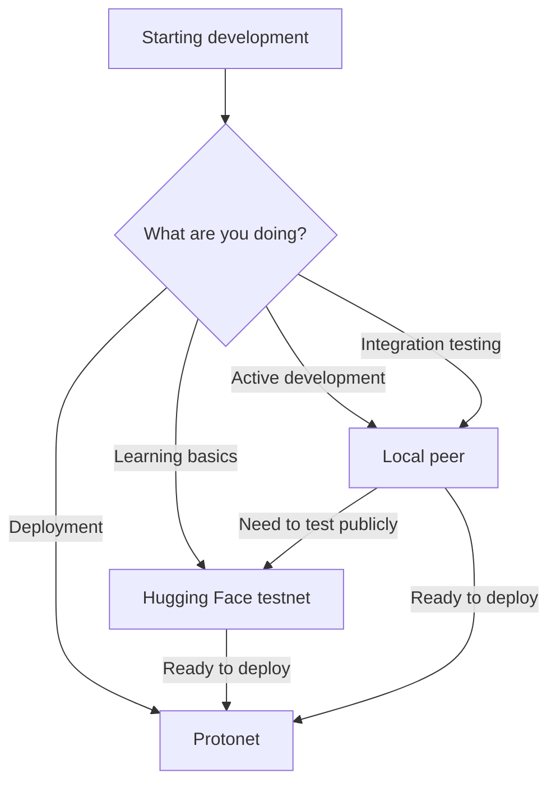

# Networks

Convex is not a single network. The same peer software, client SDKs and Convex Lisp run against a production network, public testnets, and a peer on your own laptop — you switch between them by changing a URL. This page covers which one to use, how to reach it, and what changes when you move between them.

## Network reference

| Network | Type | HTTP | Binary | Faucet | Genesis hash |
|---|---|---|---|---|---|
| **Protonet** | Production | `https://peer.convex.live` | `peer.convex.live:18888` | ❌ | `0xb0e44f2a...` (stable) |
| **Hugging Face testnet** | Testnet | `https://mikera1337-convex-testnet.hf.space` | ❌ | ✅ | changes on reset |
| **Local peer** | Development | `http://localhost:8080` | `localhost:18888` | ✅ | new on each store |

**HTTP** is the REST API — JSON over HTTPS, and the right choice for web apps and anything behind a corporate proxy. **Binary** is the native peer protocol over TCP: a persistent connection with lower per-call overhead, used by the Java SDK and by peers talking to each other. Both accept the same transactions and queries.

## Protonet

Protonet is the production network. Convex Coins on it have real value, its state is never reset, and there is no faucet — you fund an account by receiving a transfer from one that already holds coins.

Its genesis hash is stable and is the thing to pin in production code:

```
0xb0e44f2a645abfa539f5b96b7a0eabb0f902866feaff0f7c12d1213e02333f13
```

Verify it before submitting a transaction that matters, and fail closed if it does not match. The [peer operations guide](peer-operations#verifying-network-identity) has working examples for each SDK, and explains why the check cannot be done with a CVM query.

## Hugging Face testnet

The public testnet runs on Hugging Face Spaces and exists for learning, demos and pre-deployment testing. It has a faucet, so an account costs nothing, and its coins are worth nothing.

It is HTTP only — there is no binary port — so use a local peer if you need to exercise the binary protocol. It may also reset without notice, which changes its genesis hash and discards every account and actor on it. Anything you want to keep, keep in source control.

## Local peer

A local peer is a complete Convex network with one participant, running on your machine. It is the fastest option — no network round trip — gives you the binary protocol, creates and funds accounts on demand, and works offline. It is what to develop and run integration tests against.

The trade-off is that it is genuinely a different network: a new store generates a new genesis hash, so nothing you deploy against it exists anywhere else, and a pinned genesis hash in your test setup breaks the first time you start from a clean directory.

See [Local Testnets](peer-operations/local-testnets) for the setup options.

## Choosing a network

| What you're doing | Use | Why |
|---|---|---|
| Learning Convex | Hugging Face testnet | Nothing to install, free funds, safe to break |
| Day-to-day development | Local peer | Fastest loop, binary protocol, works offline |
| Integration tests | Local peer | Isolated and repeatable — reset state between runs |
| Public demo or shared staging | Hugging Face testnet | Reachable by other people |
| Production | Protonet | Real value, persistent state, no resets |



## Connecting

Every network speaks the same client API, so switching is mostly a matter of changing the endpoint. Note that the class you use depends on the *protocol*, not the network: in Java, `ConvexJSON` is the REST client and `Convex` speaks the binary protocol.

```java
// Testnet — HTTP only, so the REST client
ConvexJSON convex = ConvexJSON.connect("https://mikera1337-convex-testnet.hf.space");

// Production over HTTP
ConvexJSON convex = ConvexJSON.connect("https://peer.convex.live");

// Production over the binary protocol — note the peer port, not 443
Convex convex = Convex.connect("peer.convex.live:18888");
```

The [peer operations guide](peer-operations) covers connection types, timeouts, health monitoring and troubleshooting in detail.

## What changes when you move networks

Moving code from a testnet to Protonet changes three things:

**Funding.** There is no faucet on Protonet. Any code path that calls a faucet endpoint to obtain coins will fail there, so account funding needs a different mechanism in production.

**Irreversibility.** A testnet mistake costs nothing and a reset erases it. A Protonet transaction is final — there is no administrator who can reverse it.

**Keys.** Use different keys per network. A key that has touched a testnet has been through test tooling, sample repositories and possibly a screen share; it is not a production key, and treating it as one is how test credentials end up holding real value.

A local peer is private and never exposed to the network, which makes it safe for testing — but its state is ephemeral unless you configure a persistent store, so treat anything you have not persisted as disposable.

## Finding other networks

Community-run peers and additional test networks are announced in the [Discord `#network-status` channel](https://discord.com/invite/xfYGq4CT7v) and by the [Convex Foundation](https://convex.world). Verify the genesis hash of any peer you have not used before: the URL tells you who you are talking to, but only the genesis hash tells you which network they are on.

## Next steps

- **[Peer Operations](peer-operations)** — connecting, verifying, monitoring and troubleshooting
- **[Client SDKs](/docs/tutorial/client-sdks)** — connect from Java, TypeScript or Python
- **[Faucet Guide](/docs/tutorial/coins/faucet)** — getting test funds
- **[Convex Peer](/docs/products/convex-peer)** — running a peer of your own
